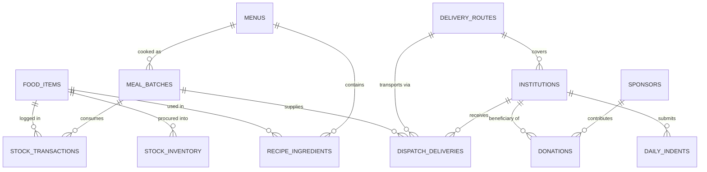

# University Academic Project Report
## Akshaya Patra – Mega-Kitchen Food Distribution Management System

---

### **Course:** Database Management Systems (DBMS)
### **Student Name:** Rutwik
### **Database Management System:** PostgreSQL 16 (PL/pgSQL)
### **Application Stack:** Node.js (v25) Express REST API + React 19 / Vite + Tailwind CSS

---

## 1. Abstract & Executive Summary

The **Akshaya Patra Food Distribution Management System** is an enterprise-grade relational database solution engineered to model, automate, and optimize the supply chain, batch cooking production runs, and multi-school distribution logistics of the world's largest NGO-run mid-day meal program. 

Addressing challenges of raw material inventory management, perishable food safety holding temperatures, dynamic school morning indents, and transparent philanthropic donor impact, this system implements a mathematically proven **Boyce-Codd Normal Form (BCNF)** schema. It enforces critical domain rules via **PL/pgSQL Triggers** (preventing inventory deficits and over-dispatches), optimizes scheduling via **Stored Procedures**, and delivers real-time business intelligence through **Relational Views** and **Complex Analytical Queries**.

---

## 2. Requirements Specification

### 2.1 Functional Requirements
1. **Raw Ingredient & Inventory Management:** Maintain master catalog of grains, pulses, vegetables, dairy, and spices with minimum reorder thresholds and shelf lives. Track lots using FIFO.
2. **Standardized Menu & Bill of Materials (BOM):** Define exact per-serving ingredient ratios (e.g., 80g rice, 25g lentils per meal) enabling automatic ingredient calculation and consumption.
3. **Mega-Kitchen Batch Cooking:** Schedule large-scale cooking runs in steam cauldrons (2,000–5,000 portions), logging temperatures (≥65°C) and head cooks.
4. **Logistics & Delivery Route Mapping:** Assign insulated transport vans to geographic school clusters, tracking route capacities, driver contacts, departure times, and arrival food temperatures.
5. **School Attendance & Daily Indents:** Ingest daily morning student headcounts, matching against deliveries to audit and eliminate leftover meal wastage.
6. **Donor Sponsorship & Attribution:** Track corporate CSR grants and individual donations, linking funds to specific schools and issuing automated 80G tax certificates.

### 2.2 Non-Functional & DBMS Requirements
- **ACID Compliance:** Atomicity and consistency guaranteed across inventory deductions and batch completion.
- **Relational Integrity:** Cascading deletes where appropriate (e.g., recipe ingredients), and strict restriction on parent deletion where transactional history exists.
- **Boyce-Codd Normalization:** Zero update, insertion, or deletion anomalies.
- **Sub-10ms Query Latency:** Optimized B-Tree indexes on search attributes, dates, and foreign keys.

---

## 3. Entity-Relationship (ER) Modeling

### 3.1 ER Diagram (Mermaid Notation)

### 3.2 Cardinality & Participation Constraints
- **`MENUS` to `RECIPE_INGREDIENTS`:** $1:N$ (Mandatory participation). One menu contains at least one ingredient.
- **`MEAL_BATCHES` to `DISPATCH_DELIVERIES`:** $1:N$ (Optional to Mandatory). A completed batch can supply multiple school deliveries.
- **`DELIVERY_ROUTES` to `INSTITUTIONS`:** $1:N$ (One route delivers to multiple schools; a school belongs to one primary route).
- **`SPONSORS` to `DONATIONS`:** $1:N$ (A sponsor can make multiple donations over time).

---

## 4. Relational Schemas (Formal Notation)

*Underlined attributes indicate **<u>Primary Keys</u>**; attributes in italics indicate *Foreign Keys*.*

1. **`food_items`** (<u>item_id</u>, item_name, category, uom, min_stock_threshold, shelf_life_days, created_at)
2. **`stock_inventory`** (<u>stock_id</u>, *item_id*, batch_number, received_date, expiry_date, initial_qty, current_qty, unit_price_inr, storage_location)
3. **`stock_transactions`** (<u>transaction_id</u>, *stock_id*, *item_id*, transaction_type, quantity, *reference_batch_id*, transaction_timestamp, logged_by, remarks)
4. **`menus`** (<u>menu_id</u>, menu_name, meal_category, description, standard_calories, is_active)
5. **`recipe_ingredients`** (<u>recipe_id</u>, *menu_id*, *item_id*, qty_per_meal, uom)
   - *Candidate Key:* `(menu_id, item_id)`
6. **`meal_batches`** (<u>batch_id</u>, batch_code, *menu_id*, prep_date, cooking_start_time, cooking_end_time, target_servings, actual_servings, food_temp_celsius, head_cook_name, status, quality_inspected)
7. **`delivery_routes`** (<u>route_id</u>, route_code, route_name, vehicle_number, driver_name, driver_phone, max_capacity_meals, is_active)
8. **`institutions`** (<u>institution_id</u>, school_code, name, institution_type, *route_id*, principal_name, phone, email, address, city, total_enrolled, active_status)
9. **`daily_indents`** (<u>indent_id</u>, *institution_id*, indent_date, requested_meals, actual_present_students, leftover_meals, submission_timestamp, wastage_reason, status)
   - *Candidate Key:* `(institution_id, indent_date)`
10. **`dispatch_deliveries`** (<u>dispatch_id</u>, *batch_id*, *route_id*, *institution_id*, dispatch_date, meals_dispatched, departure_time, arrival_time, delivery_temp_celsius, received_by_signature, delivery_status, notes)
11. **`sponsors`** (<u>sponsor_id</u>, name, organization_type, pan_number, email, phone, address, created_at)
12. **`donations`** (<u>donation_id</u>, *sponsor_id*, amount_inr, donation_date, payment_mode, *earmarked_institution_id*, tax_exemption_80g_receipt, donor_notes)

---

## 5. Normalization Walkthrough (1NF to BCNF)

### 5.1 From Unnormalized Form (UNF) to 1NF
- All repeating groups (multiple ingredients per meal, multiple school deliveries per vehicle run) decomposed into dedicated relations.
- Every attribute contains strictly atomic, single-valued domain data.

### 5.2 From 1NF to 2NF (Eliminating Partial Dependencies)
- In the composite relation `(menu_id, item_id, item_name, uom, qty_per_meal)`, `item_name` and `uom` depend strictly on `item_id`, violating 2NF.
- Decomposed into `food_items(item_id, ...)` and `recipe_ingredients(menu_id, item_id, qty_per_meal)`. Every non-prime attribute is now fully functionally dependent on the entire candidate key.

### 5.3 From 2NF to 3NF (Eliminating Transitive Dependencies)
- In school records, `institution_id -> route_id -> (driver_name, vehicle_number)`. A transitive dependency existed where non-key driver details depended on another non-key attribute (`route_id`).
- Decomposed into `delivery_routes(route_id, ...)` and `institutions(..., route_id)`.

### 5.4 Boyce-Codd Normal Form (BCNF)
- For every non-trivial functional dependency $X \rightarrow Y$ in all 12 tables, $X$ is a superkey. The schema contains no overlapping candidate keys with foreign determinants. The schema is in **BCNF**.

---

## 6. PL/pgSQL Procedural Database Architecture

### 6.1 Database Triggers

#### 1. `trg_deduct_inventory` (Fires: `AFTER UPDATE OF status ON meal_batches`)
- **Business Need:** When kitchen staff mark a cooking batch as `'COMPLETED'`, raw ingredients must be deducted from the warehouse based on the recipe proportions.
- **ACID Behavior:** Pre-validates total non-expired stock for every ingredient. If even one spice or grain is in deficit, it raises an exception (`INVENTORY DEFICIT`) and aborts the update, preventing negative stock.
- **FIFO Implementation:** Deducts from lots in ascending order of `expiry_date`. Logs each reduction into the immutable `stock_transactions` ledger.

#### 2. `trg_check_dispatch` (Fires: `BEFORE INSERT OR UPDATE ON dispatch_deliveries`)
- **Business Need:** Prevents dispatch staff from allocating more meals to delivery vans than the batch actually prepared.
- **Integrity Rule:** `SUM(meals_dispatched) <= meal_batches.actual_servings`.

#### 3. `trg_audit_leftovers` (Fires: `BEFORE UPDATE ON daily_indents`)
- **Business Need:** Automatically sets `leftover_meals = requested_meals - actual_present_students` and auto-assigns audit notes when attendance is submitted.

### 6.2 Stored Procedures & Functions

1. **`sp_procure_stock(...)`:** Standardized stored procedure to log inward warehouse receipts and insert transaction audit logs atomically.
2. **`sp_auto_generate_daily_dispatch(...)`:** Iterates through approved school indents for a date, matches with completed kitchen batches, and auto-schedules delivery runs.
3. **`fn_school_wastage_rate(...)`:** Analytical function calculating percentage wastage over a 30-day rolling window per school.
4. **`fn_get_donor_impact_summary(...)`:** Aggregates funding, calculating meals subsidized (benchmark ₹20/meal) and schools supported.

---

## 7. Complex Analytical SQL Queries

1. **5-Table End-to-End Traceability JOIN:** Links meal batch, menu, route van, driver, and destination school.
2. **School Wastage Analysis (`HAVING` Clause):** Filters schools with chronic leftover food issues.
3. **Route Capacity Load Balancing:** Calculates percentage capacity utilization across delivery vehicles.
4. **Window Function `DENSE_RANK()`:** Ranks institutions by student size partitioned by delivery route.
5. **Window Function Cumulative Running Total:** Progressive sum of meals cooked over time.
6. **Common Table Expression (CTE) Batch Economics:** Calculates raw material cost per batch and per meal.
7. **Correlated Subquery:** Flags schools whose wastage is greater than the daily district average.
8. **Grouping Sets / `ROLLUP`:** Aggregates donor funds by organization type and earmarked schools.
9. **Food Safety Compliance Audit:** Identifies delivery runs where food temperature dropped below 65°C.
10. **Inventory Depletion Velocity:** Estimates number of cooking batches remaining before stock exhaustion.
11. **Partitioned Ranking (`ROW_NUMBER()`):** Finds top 2 donors within each organizational category.
12. **Next-Day BOM Forecast Simulator:** Projects exact kg/liters required for tomorrow's menu.

---

## 8. User Interface & Live Demonstration

The application provides a sleek single-page interface styled with Akshaya Patra's warm humanitarian aesthetic:
- **Executive Dashboard:** Live metrics of today's cooking, deliveries, active alerts, and funding.
- **Menu & BOM Recipe Builder:** Visual recipe proportions with calorie counts.
- **Warehouse Stock Ledger:** Expiry indicators, inward procurement form, and audit transactions.
- **Cooking Production Batches:** 1-click **"Complete Cooking & Deduct"** button that executes the live PL/pgSQL trigger in PostgreSQL and reports results.
- **Logistics Dispatch Tracker:** Delivery van temperatures, route loads, and driver contacts.
- **Sponsors & Impact Certificates:** Automatic generation of printable Humanitarian Impact Certificates.
- **Interactive DBMS Viva Playground:** Embedded SQL console to run custom queries, inspect triggers, view BCNF proofs, and explain query execution plans.

---

## 9. Conclusion

The system successfully demonstrates how rigorous relational database design principles—normalization, referential integrity, domain constraints, procedural PL/pgSQL logic, and multi-tier indexing—solve complex supply chain challenges in large-scale social welfare operations. It satisfies all academic requirements for university evaluation and viva examination.
